# ЛР 1. Loki + Zabbix + Grafana

## Цель работы

Подключить к тестовому сервису Nextcloud мониторинг и сбор логов и настроить визуализацию полученных данных в Grafana.

## Используемое программное обеспечение

Работа выполнялась на ноутбуке под управлением Windows 11 с Docker Desktop (Docker Engine 29.9.3). Стенд состоит из семи контейнеров, описанных в одном файле [docker-compose.yml](docker-compose.yml). Наблюдаемым сервисом служит Nextcloud 29.0.6. Логи собирает агент Promtail 2.9.0 и передаёт их в хранилище Loki 2.9.0. Доступность Nextcloud проверяет Zabbix 6.4.21, который состоит из сервера (контейнер zabbix-back), веб-интерфейса на nginx (контейнер zabbix-front) и базы данных PostgreSQL 15. Данные из Loki и Zabbix выводятся в Grafana 11.2.0, для связи с Zabbix в неё установлен плагин alexanderzobnin-zabbix-app версии 4.5.4.

Файлы стенда лежат рядом с отчётом: [docker-compose.yml](docker-compose.yml), [promtail_config.yml](promtail_config.yml) и [template.yml](template.yml).

## Ход работы

### Часть 1. Логирование

Для запуска стенда был создан файл [docker-compose.yml](docker-compose.yml). Сервисы и порты в нём совпадают с методическими указаниями. Для логирования важно, что том `nc-data` подключён сразу к двум контейнерам. В Nextcloud он смонтирован в каталог данных `/var/www/html/data`, куда сервис пишет журнал `nextcloud.log`, а в Promtail в каталог `/opt/nc_data`, поэтому Promtail читает журнал Nextcloud как обычный локальный файл. В начало файла добавлена строка `name: lab1` с именем проекта. Без неё Docker Compose строит имя проекта из названия папки, и от названия «Лаб 1», из которой запускался стенд, после удаления кириллицы и пробела осталась бы только цифра «1».

Файл [promtail_config.yml](promtail_config.yml) задаёт адрес, по которому Promtail отправляет записи в Loki (`http://loki:3100/loki/api/v1/push`), и правило сбора. Агент читает все файлы `*.log` из каталога `/opt/nc_data` и присваивает записям метку `job="nextcloud_logs"`, по которой они затем ищутся в Grafana. Позиции чтения файлов сохраняются в `/tmp/positions.yaml`, чтобы после перезапуска контейнера Promtail не отправлял уже переданные строки повторно.

Образы всех сервисов были заранее загружены командой `docker compose pull`, после чего стенд был запущен. Команда `docker ps` показала семь контейнеров в состоянии Up (рисунок 1).

```bash
docker compose pull
docker compose up -d
docker ps --format "table {{.Names}}\t{{.Image}}\t{{.Status}}\t{{.Ports}}"
```

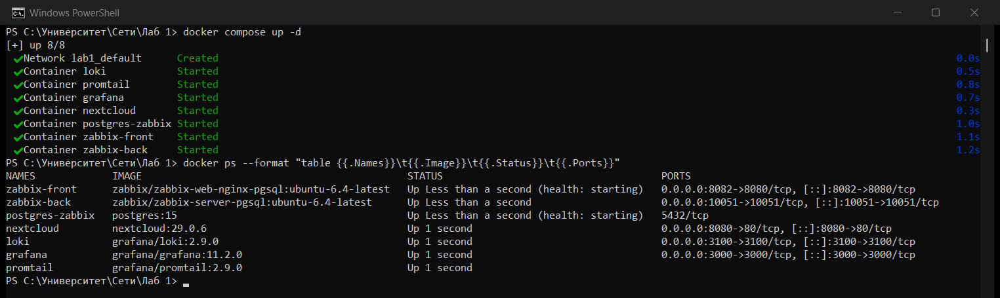

*Рисунок 1. Запуск контейнеров и вывод команды docker ps*

Затем Nextcloud был инициализирован через веб-интерфейс по адресу http://localhost:8080. На странице установки была создана учётная запись администратора `admin`, а в качестве базы данных оставлена предложенная по умолчанию SQLite (рисунок 2). Предложение установить рекомендуемые приложения было пропущено.

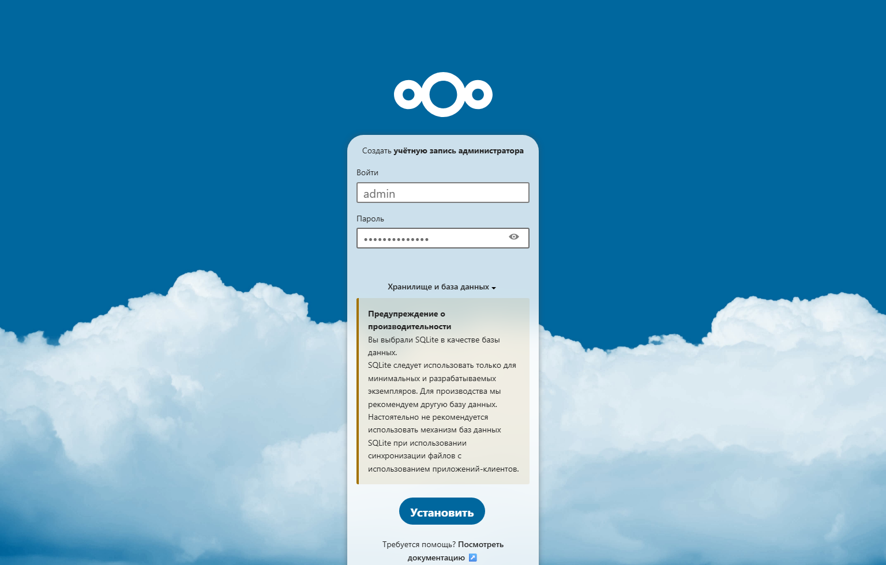

*Рисунок 2. Установка Nextcloud*

После установки в каталоге данных появился файл `nextcloud.log`. Его последние строки были выведены командой

```bash
docker exec nextcloud tail -n 5 /var/www/html/data/nextcloud.log
```

Каждая строка журнала представляет собой JSON-объект с уровнем записи (`level`), временем, адресом клиента, адресом запроса и текстом сообщения (рисунок 3). К этому моменту в журнале было пять записей. Четыре из них имеют уровень 2 (предупреждение) и сообщают, что Nextcloud не стал подключаться к localhost, так как это нарушает правила локального доступа. Пятая запись имеет уровень 3 (ошибка) и относится к первому запросу, который пришёл до установки, когда файла `config.php` ещё не было.

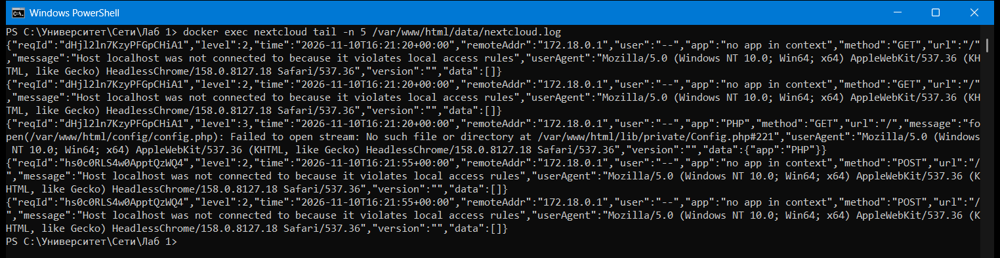

*Рисунок 3. Содержимое файла nextcloud.log*

Чтобы проверить, что Promtail подхватил журнал, были просмотрены логи его контейнера командой `docker logs promtail` (рисунок 4). В них есть строка «Adding target» с меткой `job="nextcloud_logs"` и строка `msg="Seeked /opt/nc_data/nextcloud.log"`, которая означает, что агент открыл файл и передаёт новые строки из него в Loki. Записи «received file watcher event» показывают, что Promtail следит за всем каталогом и замечает появление новых файлов Nextcloud.

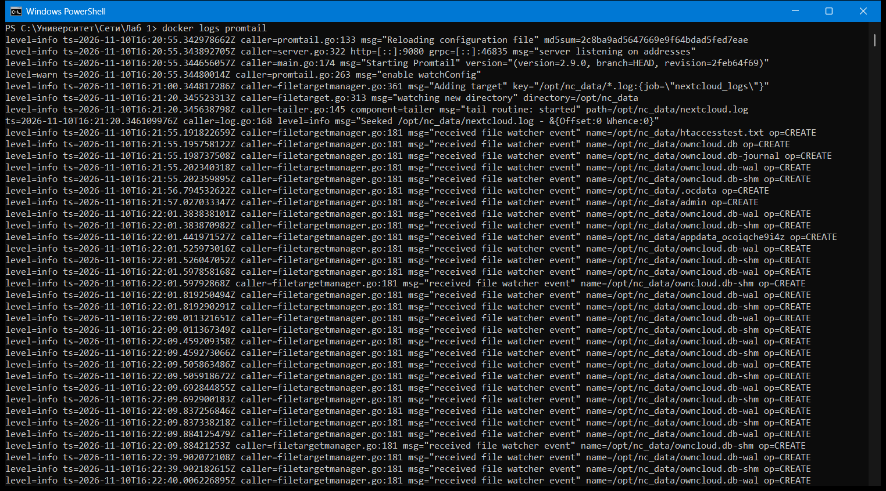

*Рисунок 4. Логи Promtail*

### Часть 2. Мониторинг

Веб-интерфейс Zabbix открывается по адресу http://localhost:8082, вход выполнялся под учётной записью `Admin` с паролем `zabbix`. В разделе Data collection → Templates через кнопку Import был загружен шаблон из файла [template.yml](template.yml) (рисунок 5). Перед импортом Zabbix показал список добавляемых объектов (шаблон, элемент данных и триггер) и запросил подтверждение, потому что в правилах импорта отмечен пункт Delete missing.

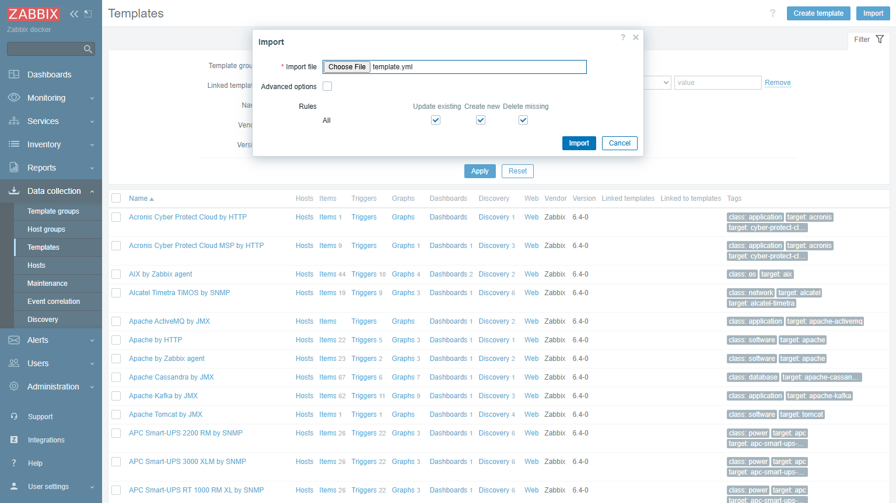

*Рисунок 5. Импорт шаблона в Zabbix*

Шаблон Test ping template содержит один элемент данных Nextcloud: ping service типа HTTP agent. Раз в минуту (это интервал по умолчанию) Zabbix запрашивает страницу `http://{HOST.HOST}/status.php`, где макрос `{HOST.HOST}` заменяется на имя узла. Nextcloud возвращает на этот запрос JSON-объект, в котором поле `maintenance` показывает, включён ли режим обслуживания. Так как для элемента задан формат вывода JSON, Zabbix помещает тело ответа в поле `body`, поэтому на первом шаге предобработки значение извлекается выражением JSONPath `$.body.maintenance`. Следующие два шага заменяют `false` на `healthy` и `true` на `unhealthy`. Триггер Nextcloud is in maintenance mode с важностью Disaster срабатывает, когда последнее значение равно `unhealthy`, и закрывается, когда снова приходит `healthy`.

Сервер Zabbix обращается к Nextcloud по имени контейнера `nextcloud` внутри сети Docker. Nextcloud обрабатывает только запросы к доверенным доменам, поэтому имя `nextcloud` было добавлено в параметр `trusted_domains`. Команда выполнялась через утилиту occ от имени пользователя `www-data`, после чего команда `config:system:get trusted_domains` показала два доверенных домена, `localhost:8080` и `nextcloud` (рисунок 6).

```bash
docker exec -u www-data -it nextcloud php occ config:system:set trusted_domains 1 --value="nextcloud"
docker exec -u www-data -it nextcloud php occ config:system:get trusted_domains
```

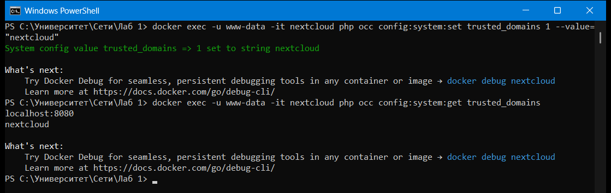

*Рисунок 6. Добавление имени nextcloud в trusted_domains*

Далее в разделе Data collection → Hosts был создан узел с именем `nextcloud` и видимым именем Nextcloud Server в группе Applications, к которому привязан шаблон Test ping template (рисунок 7). Имя узла совпадает с именем контейнера, поэтому адрес в элементе данных принимает вид `http://nextcloud/status.php`. Примерно через 15 с после сохранения узла в разделе Monitoring → Latest data появилось первое значение `healthy` (рисунок 8).

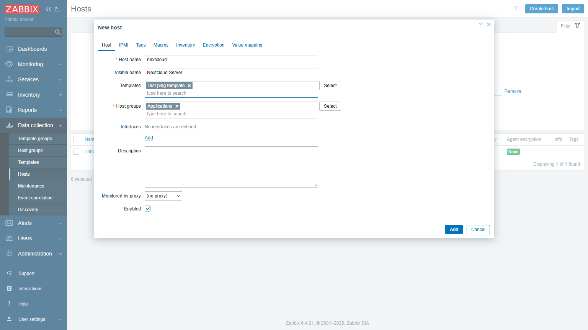

*Рисунок 7. Создание узла nextcloud*

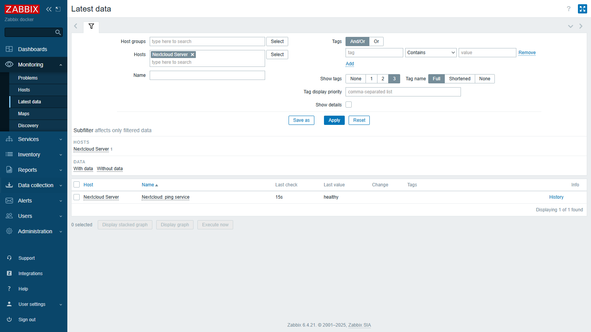

*Рисунок 8. Значение элемента данных в разделе Latest data*

Веб-интерфейс Zabbix в контейнере по умолчанию показывает время часового пояса Europe/Riga, поэтому в настройках пользователя Admin был выбран пояс Europe/Moscow, чтобы время на страницах совпадало с местным. Для проверки триггера в Nextcloud был включён режим обслуживания, после чего запрос к `status.php` вернул `"maintenance":true` (рисунок 9).

```bash
docker exec -u www-data -it nextcloud php occ maintenance:mode --on
curl.exe http://localhost:8080/status.php
```

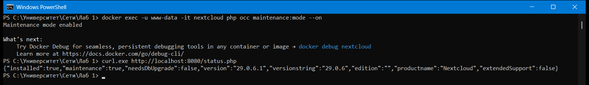

*Рисунок 9. Включение режима обслуживания и ответ status.php*

При следующей проверке в 19:28:31 Zabbix получил значение `unhealthy`, и в разделе Monitoring → Problems появилась проблема Nextcloud is in maintenance mode с важностью Disaster (рисунок 10). Режим обслуживания был выключен командой `php occ maintenance:mode --off`, и при проверке в 19:29:31 проблема получила статус RESOLVED (рисунок 11). Длительность проблемы составила 1 мин.

```bash
docker exec -u www-data nextcloud php occ maintenance:mode --off
```

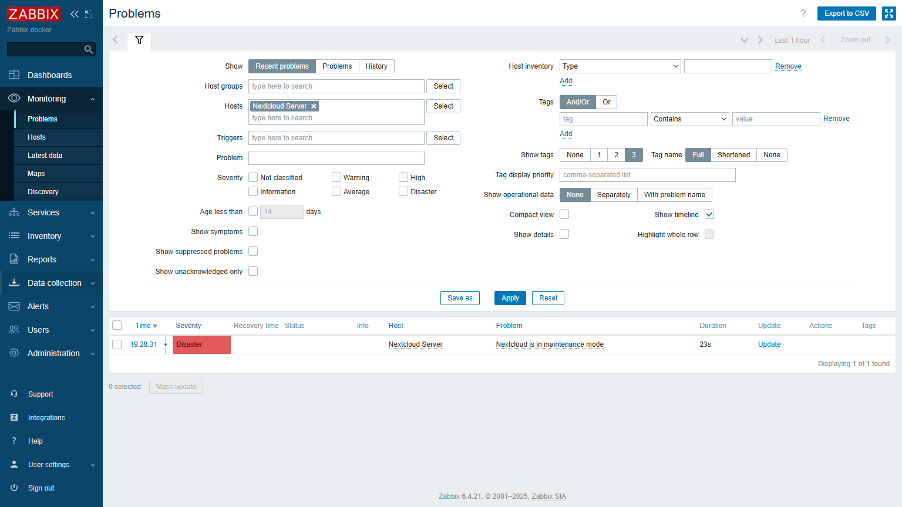

*Рисунок 10. Проблема Nextcloud is in maintenance mode*

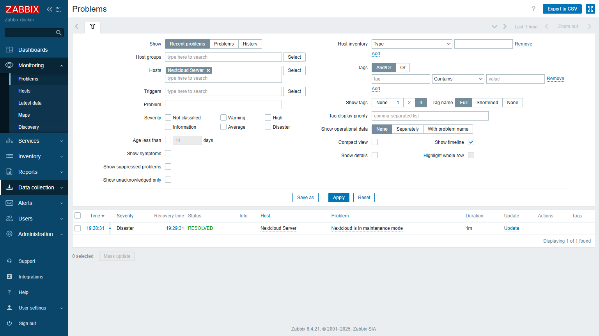

*Рисунок 11. Проблема в статусе RESOLVED*

### Часть 3. Визуализация

Для работы с Zabbix в Grafana нужен плагин alexanderzobnin-zabbix-app. Он был установлен утилитой grafana cli внутри контейнера, после чего контейнер Grafana был перезапущен (рисунок 12). Версия плагина 4.5.4 указана явно, потому что актуальная на момент выполнения работы версия 6.10.2 требует Grafana не ниже 11.6, а в стенде используется Grafana 11.2.0, утилита которой совместимость версий при установке не проверяет.

```bash
docker exec -it grafana bash -c "grafana cli plugins install alexanderzobnin-zabbix-app 4.5.4"
docker restart grafana
```

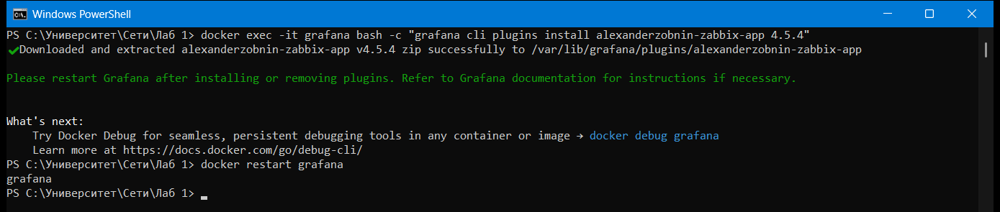

*Рисунок 12. Установка плагина Zabbix и перезапуск Grafana*

В веб-интерфейсе Grafana по адресу http://localhost:3000 плагин был включён в разделе Administration → Plugins and data → Plugins (рисунок 13). Затем в разделе Connections → Data sources были добавлены два источника данных. Для Loki (`my_loki_datasource`) указан адрес `http://loki:3100`, и проверка Save & test завершилась сообщением «Data source successfully connected» (рисунок 14). Для Zabbix (`my_zabbix_datasource`) указаны адрес API `http://zabbix-front:8080/api_jsonrpc.php`, тип аутентификации User and password и учётная запись `Admin` с паролем `zabbix`, а проверка вернула версию API Zabbix 6.4.21 (рисунок 15). В адресах указаны имена контейнеров и их внутренние порты, так как Grafana обращается к сервисам внутри сети Docker, а не через порты, проброшенные на компьютер.

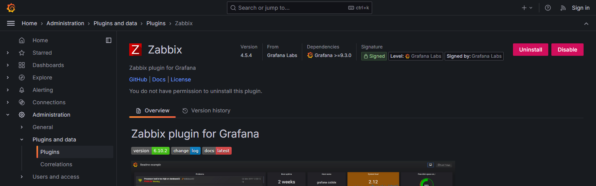

*Рисунок 13. Плагин Zabbix в Grafana*

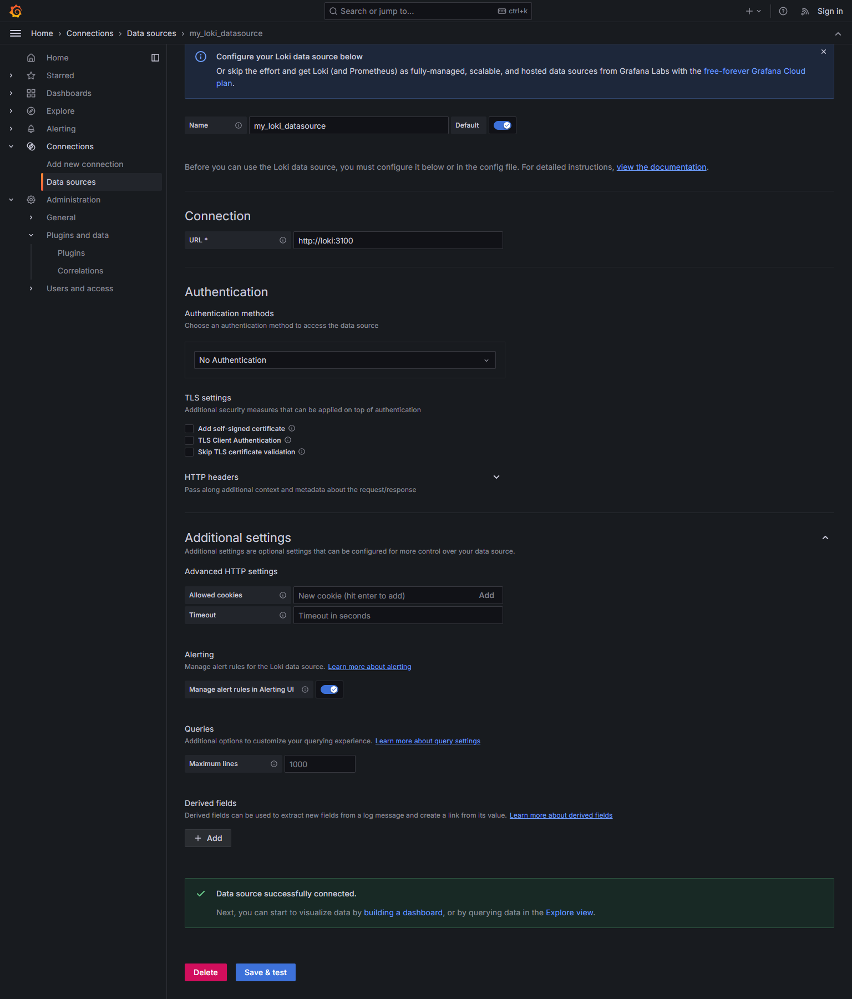

*Рисунок 14. Подключение источника данных Loki*

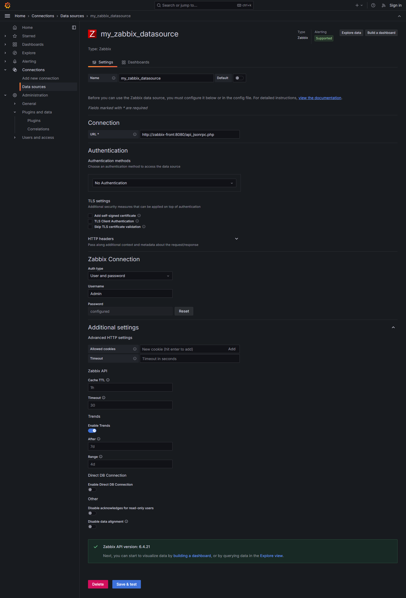

*Рисунок 15. Подключение источника данных Zabbix*

В разделе Explore запрос к Loki по метке `job="nextcloud_logs"` вернул все пять записей журнала Nextcloud (рисунок 16). Запрос к Zabbix с типом Text по группе Applications, узлу Nextcloud Server и элементу Nextcloud: ping service вернул таблицу значений элемента с шагом 1 мин. Значение в 19:28:31 равно `unhealthy`, остальные равны `healthy` (рисунок 17).

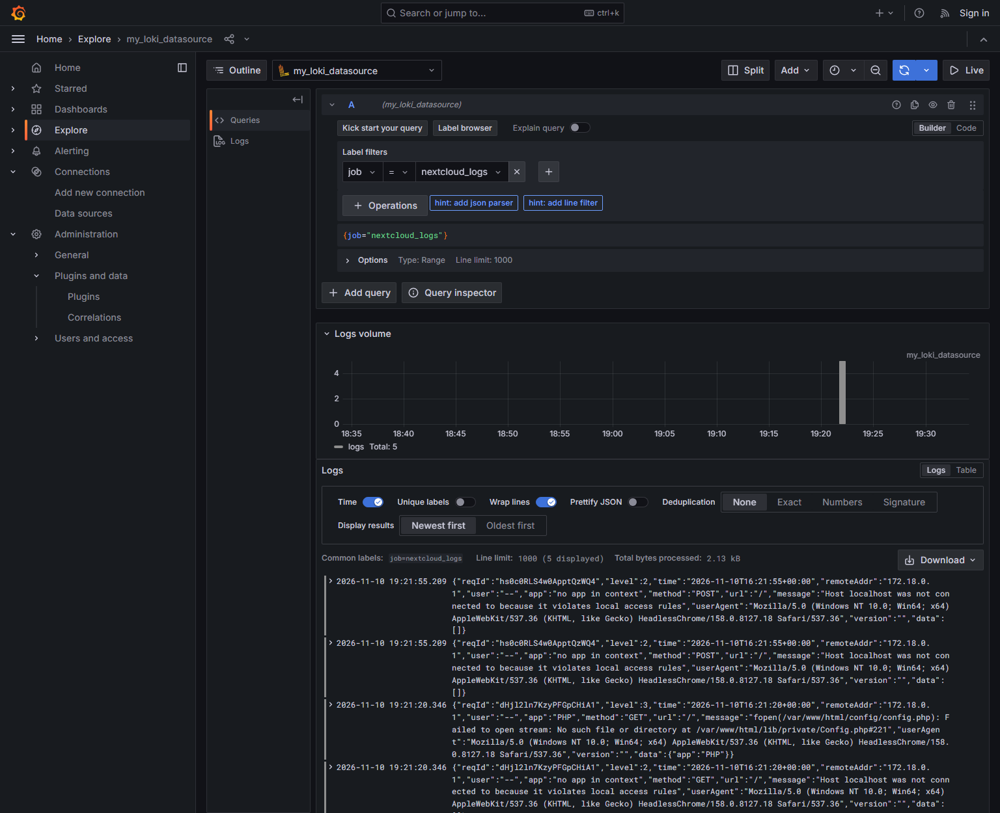

*Рисунок 16. Логи Nextcloud в Explore*

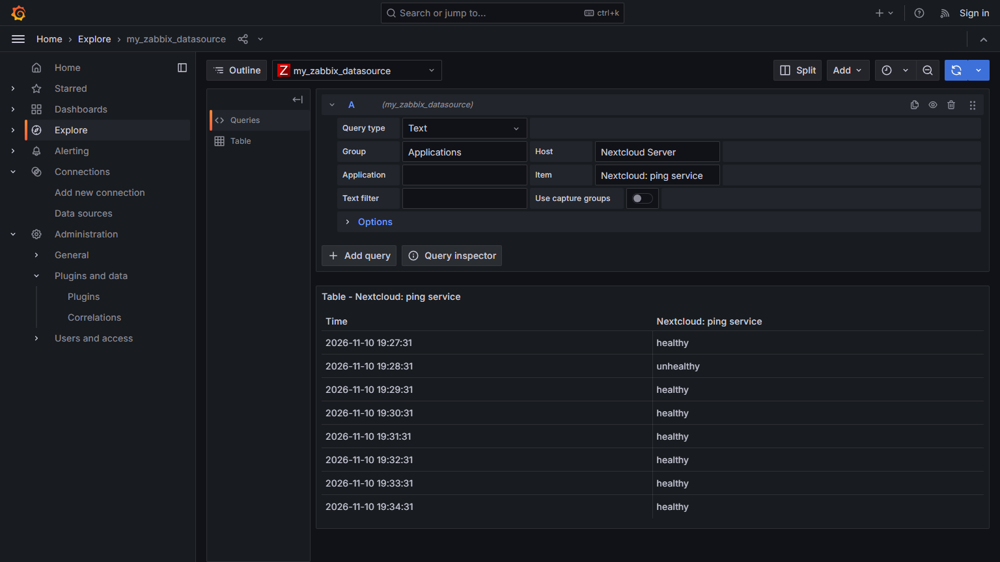

*Рисунок 17. Значения элемента Nextcloud: ping service в Explore*

## Выполнение задания

В разделе Explore были выполнены запросы к Loki на языке LogQL. Первый запрос разбирает каждую строку журнала как JSON и оставляет от неё только уровень и текст сообщения, поэтому записи читаются проще, чем исходный JSON (рисунок 18).

```
{job="nextcloud_logs"} | json | line_format "{{.level}} {{.message}}"
```

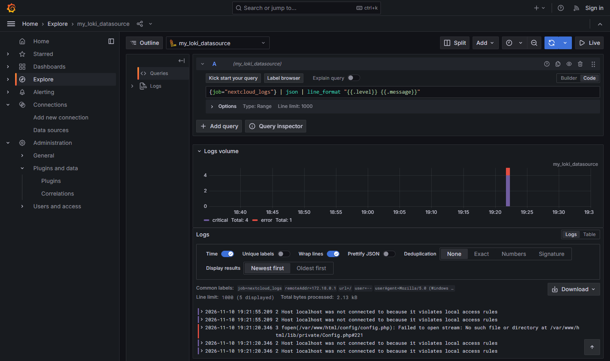

*Рисунок 18. Результат запроса с line_format*

После разбора JSON у записей появилась метка `level`, и на гистограмме Logs volume Grafana подписала записи уровня 2 как critical, а уровня 3 как error. Это совпадает со шкалой syslog, где 2 означает critical, тогда как в Nextcloud уровень 2 соответствует предупреждению.

Второй запрос метрический. Для каждого уровня записей он считает их количество в окне 5 мин, а Grafana строит по результату график (рисунок 19).

```
sum by (level) (count_over_time({job="nextcloud_logs"} | json [5m]))
```

Все пять записей появились в журнале около 19:21-19:22, поэтому следующие пять минут счётчик уровня 2 держится на значении 4, а счётчик уровня 3 на значении 1. Когда записи выходят из окна, линии обрываются, так как новых записей в журнале больше не было.

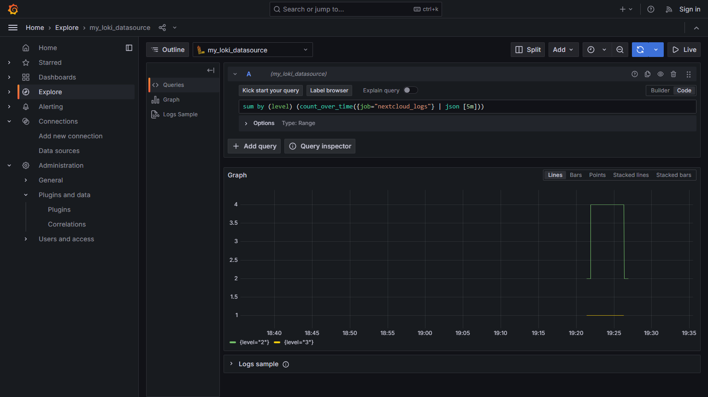

*Рисунок 19. Количество записей журнала по уровням*

Затем был создан дашборд Nextcloud из двух панелей (рисунок 20). Панель Nextcloud status типа Stat получает данные из Zabbix тем же запросом, что и в Explore, и показывает последнее значение элемента. В её настройках заданы сопоставления значений (Value mappings). Значение `healthy` выводится как «Nextcloud is: HEALTHY» на зелёном фоне, значение `unhealthy` как «Nextcloud is: UNHEALTHY» на красном. Панель Nextcloud logs типа Table выводит результат запроса `{job="nextcloud_logs"}` к Loki. Преобразование Organize fields by name скрывает служебные поля, и в таблице остаётся только столбец Line с текстом записей.

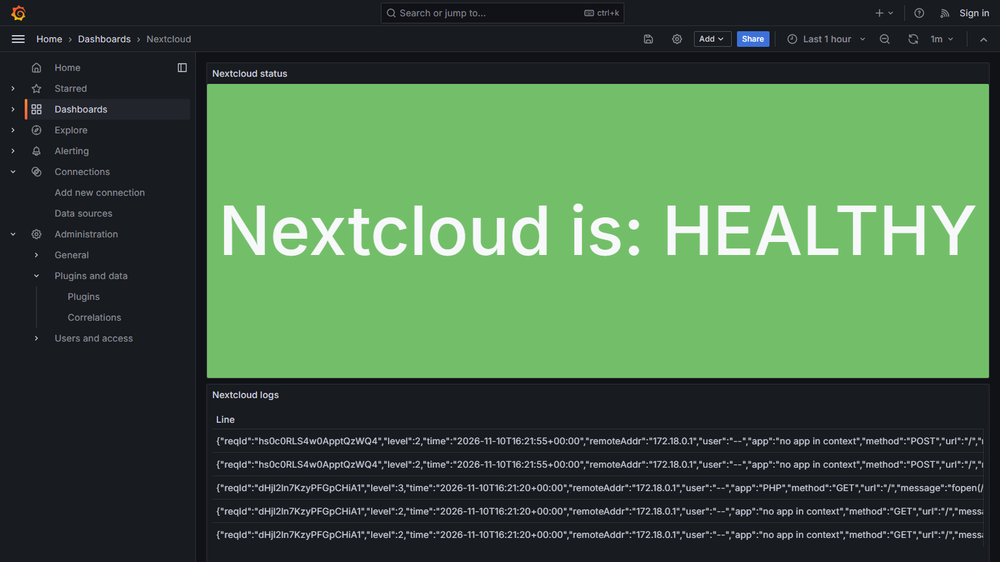

*Рисунок 20. Дашборд Nextcloud в Grafana*

## Ответы на вопросы

*1. Чем SLO отличается от SLA?*

Под SLA (Service Level Agreement) понимают соглашение об уровне обслуживания между поставщиком услуги и её потребителем. В нём записаны гарантированные значения показателей, например доступность сервиса 99,5 % за месяц, и последствия их нарушения в виде компенсаций или штрафов. SLO (Service Level Objective) означает целевое значение показателя качества обслуживания (SLI, Service Level Indicator), которое команда ставит себе сама. SLO не входит в договор и не влечёт штрафов, по нему принимают внутренние решения, например можно ли сейчас выпускать рискованные изменения. Обычно SLO задают строже SLA, чтобы команда начала реагировать раньше, чем будет нарушен договор. Так, при SLA 99,5 % в месяце из 30 дней допускается 216 мин недоступности, а внутренний SLO 99,9 % оставляет только 43,2 мин (30 · 24 · 60 · 0,001 = 43,2 мин).

*2. Чем отличается инкрементальный бэкап от дифференциального?*

Оба вида резервного копирования опираются на полную копию и сохраняют только изменённые данные, но отсчитывают изменения от разных точек. Инкрементальная копия содержит изменения с момента последнего резервного копирования любого типа, полного или инкрементального. Дифференциальная копия содержит все изменения с момента последнего полного копирования, поэтому каждая следующая дифференциальная копия больше предыдущей. Инкрементальные копии занимают мало места и создаются быстро, однако для восстановления нужна полная копия и вся цепочка инкрементальных после неё, и при потере одного звена данные за последующие дни восстановить нельзя. Для восстановления из дифференциальной копии достаточно полной копии и последней дифференциальной. Если полная копия делается в воскресенье, а остальные по будням, то для восстановления состояния на четверг в инкрементальной схеме понадобятся пять копий (с воскресенья по четверг), а в дифференциальной две (воскресная и четверговая).

*3. В чём разница между мониторингом и observability?*

Мониторинг означает сбор заранее выбранных метрик и результатов проверок, сравнение их с порогами и оповещение при выходе за пороги. Он отвечает на вопросы, которые известны заранее, например доступен ли сервис, не превышена ли загрузка процессора или не заканчивается ли место на диске. Observability (наблюдаемость) относится к свойствам самой системы. Термин пришёл из теории управления, где Р. Э. Калман в 1960 г. назвал систему наблюдаемой, если её внутреннее состояние можно восстановить по выходным сигналам. Для программной системы это значит, что по её метрикам, логам и трассировкам можно найти причину сбоя, который заранее не предвидели и под который не настраивали отдельной проверки. Мониторинг в этом смысле опирается на наблюдаемость и использует часть её данных. В данной работе Zabbix выполняет роль мониторинга, так как проверяет одно заранее заданное условие и поднимает проблему при его нарушении. Логи в Loki дают материал для поиска причин, но трассировок в стенде нет, поэтому полной наблюдаемости он не обеспечивает.

## Вывод

В работе развёрнут стенд из семи контейнеров, в котором к сервису Nextcloud 29.0.6 подключены сбор логов через Promtail и Loki и проверка доступности через Zabbix 6.4.21, а данные обоих источников выведены на дашборд Grafana. Все пять записей `nextcloud.log`, появившиеся за время работы, попали в Loki через общий том `nc-data` без изменений в самом Nextcloud и находятся в Grafana по метке `job="nextcloud_logs"`. Zabbix опрашивает `status.php` раз в минуту. Режим обслуживания включался около 19:28 и выключался около 19:29, а Zabbix обнаружил оба изменения при ближайших опросах в 19:28:31 и 19:29:31, т. е. с задержкой меньше интервала опроса, и проблема с важностью Disaster длилась 1 мин. Для подключения Zabbix к Grafana 11.2.0 пришлось явно выбрать версию плагина 4.5.4, так как актуальный выпуск 6.10.2 рассчитан на Grafana 11.6 и новее.
