# ЛР 2. Ansible + Caddy

## Цель работы

Установить на целевом сервере Ansible и с его помощью развернуть и настроить веб-сервер Caddy.

## Используемое программное обеспечение

Целевым сервером при локальном выполнении работы служил дистрибутив Ubuntu 22.04.5 LTS, установленный в WSL 3.0.5 на ноутбуке под управлением Windows 11; в дистрибутиве включён systemd, поскольку пакет Caddy устанавливает службу systemd, которую затем перезагружает плейбук. Версия 22.04 выбрана из-за того, что в Ubuntu 24.04 системный Python помечен как externally managed и pip отказывается устанавливать в него пакеты без дополнительного флага, которого в командах методических указаний нет. Ansible управлял той же машиной, на которой был установлен, поэтому в инвентаре указан localhost и команды выполнялись с локальным подключением. Использовались Python 3.10.12, pip 26.3, Ansible 10.7.0 (ansible-core 2.17.14) и Caddy 2.11.9; все команды выполнялись от имени root в рабочем каталоге `~/lab2`.

Файлы стенда: [ansible.cfg](ansible.cfg), [inventory/hosts](inventory/hosts), [caddy_deploy.yml](caddy_deploy.yml), [file_playbook.yml](file_playbook.yml), роль [roles/caddy_deploy](roles/caddy_deploy) и образец файла с токеном [secrets.yml.example](secrets.yml.example). Сам `secrets.yml` с токеном DuckDNS в репозиторий не добавлен.

## Ход работы

### Часть 1. Установка и настройка Ansible

Менеджер пакетов pip устанавливался скриптом `get-pip.py`, который был скачан утилитой curl и запущен интерпретатором python3; в результате установилась версия pip 26.3 (рисунок 1). Предупреждение в конце вывода касается запуска pip от имени root и на установку не повлияло.

```bash
curl https://bootstrap.pypa.io/get-pip.py -o get-pip.py && python3 get-pip.py
```

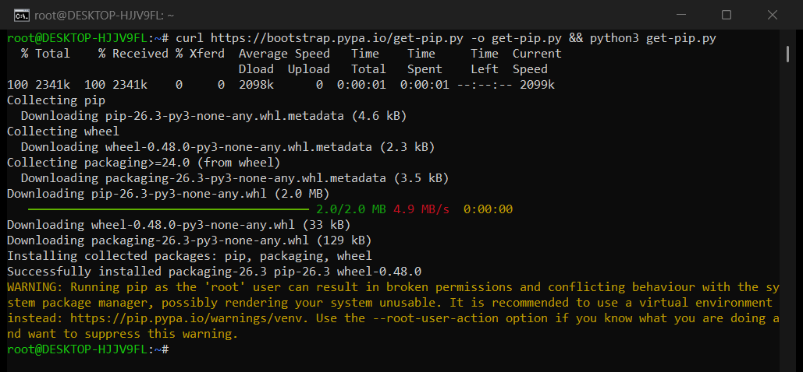

*Рисунок 1. Установка pip*

Затем через pip был установлен пакет ansible 10.7.0, который содержит коллекции модулей и зависит от ansible-core 2.17, где находятся сами команды ansible, ansible-playbook и ansible-galaxy. Более новую ветку pip не выбрал, так как ansible-core начиная с версии 2.18 требует Python 3.11, тогда как в Ubuntu 22.04 установлен Python 3.10. Команда `ansible --version` подтвердила установку и показала, что конфигурационный файл пока не найден (config file = None) (рисунок 2).

```bash
python3 -m pip install ansible
ansible --version
```

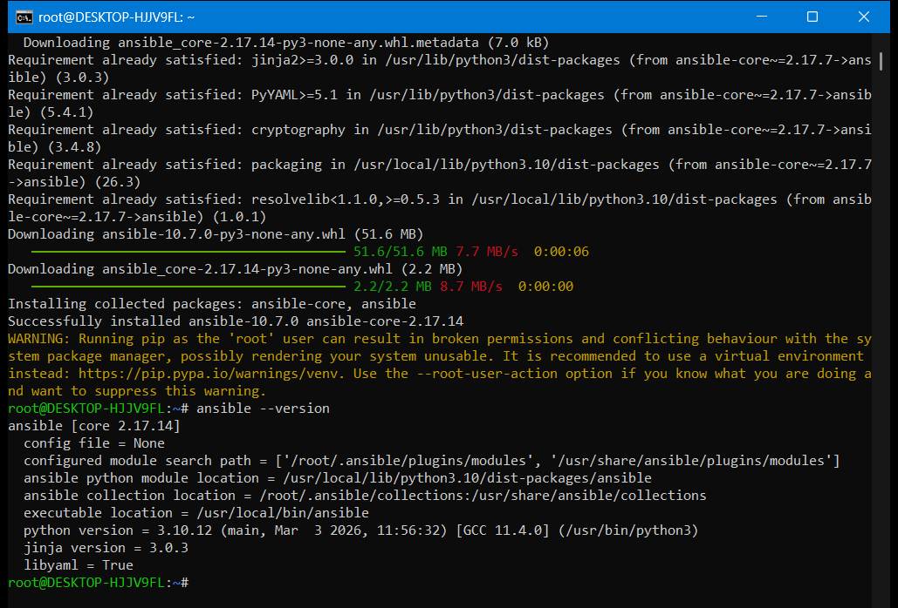

*Рисунок 2. Установка Ansible*

В рабочем каталоге `~/lab2` были созданы конфигурационный файл `ansible.cfg` (листинг 1) и файл инвентаря `inventory/hosts` (листинг 2). В `ansible.cfg` отключена проверка ключей SSH-хостов и указан путь к инвентарю, так что передавать его в каждой команде ключом -i не требуется. Инвентарь описывает группу my_servers из одного хоста local_server с адресом localhost.

*Листинг 1. Файл ansible.cfg*

```ini
[defaults]
host_key_checking = false
inventory         = inventory/hosts
```

*Листинг 2. Файл inventory/hosts*

```ini
[my_servers]
local_server ansible_host=localhost
```

Связь Ansible с хостом проверялась модулем ping с ключом -c local, который задаёт локальное подключение вместо используемого по умолчанию подключения к localhost по SSH (рисунок 3). Ответ pong означает, что Ansible выполнил модуль на хосте и получил результат. Предупреждение [WARNING] о том, что Ansible сам выбрал интерпретатор `/usr/bin/python3.10`, на результат не влияет и дальше повторяется в выводе каждой команды.

```bash
ansible my_servers -m ping -c local
```

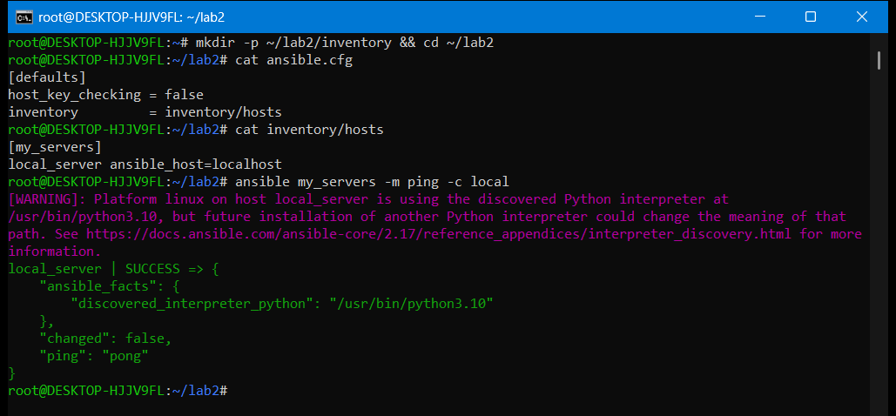

*Рисунок 3. Файлы конфигурации и проверка связи модулем ping*

Сведения о хосте (факты), которые собирает модуль setup, были отфильтрованы по имени, чтобы вывод поместился на экран (рисунок 4). По ним Ansible определил дистрибутив Ubuntu 22.04 (jammy) семейства Debian.

```bash
ansible my_servers -m setup -c local -a 'filter=ansible_distribution*'
```

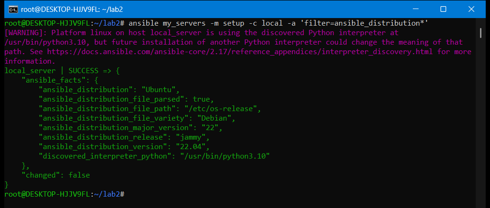

*Рисунок 4. Факты о дистрибутиве, собранные модулем setup*

Ad-hoc командами Ansible был создан и удалён тестовый файл (рисунок 5). Модуль shell записал строку test_file_content в файл `$HOME/test.txt` и вернул статус CHANGED с кодом возврата rc=0, после чего команды ls и cat показали, что файл появился в каталоге `/root` с нужным содержимым. Модуль file с параметром state=absent удалил его, что подтвердила повторная команда ls.

```bash
ansible my_servers -c local -m shell -a 'echo test_file_content > $HOME/test.txt'
ls -l $HOME/test.txt && cat $HOME/test.txt
ansible my_servers -c local -m file -a 'path=$HOME/test.txt state=absent'
ls -l $HOME/test.txt
```

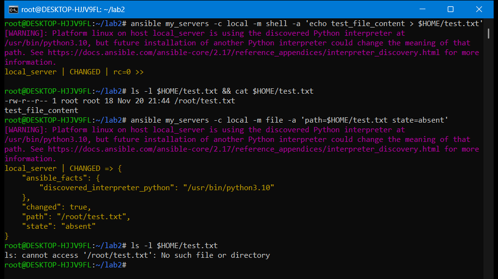

*Рисунок 5. Создание и удаление файла ad-hoc командами*

### Часть 2. Установка Caddy

Заготовка роли caddy_deploy создана командой ansible-galaxy init в каталоге `roles` (рисунок 6). В ней есть стандартные каталоги роли: tasks для задач, templates для шаблонов, vars и defaults для переменных, files для копируемых файлов, handlers для обработчиков, а также служебные meta и tests.

```bash
mkdir roles && cd roles && ansible-galaxy init caddy_deploy
```

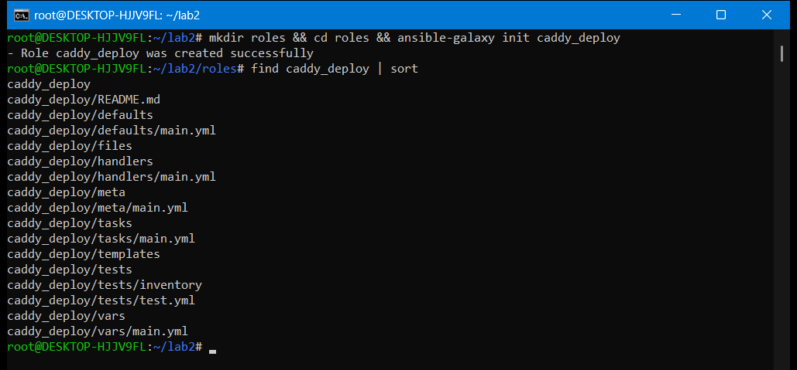

*Рисунок 6. Создание роли caddy_deploy*

В файл `roles/caddy_deploy/tasks/main.yml` перенесены задачи из методических указаний. Модуль apt устанавливает вспомогательные пакеты; apt_key добавляет ключ репозитория Caddy в отдельный файл ключей; два вызова apt_repository подключают репозиторий пакетов и репозиторий исходных кодов, после чего apt устанавливает caddy. Роль применяется к группе my_servers с локальным подключением плейбуком `caddy_deploy.yml`, созданным в рабочем каталоге (листинг 3).

*Листинг 3. Плейбук caddy_deploy.yml*

```yaml
---
- name: Install and configure Caddy webserver
  hosts: my_servers
  connection: local

  roles:
    - caddy_deploy
```

Первый запуск плейбука завершился ошибкой уже на первой задаче, потому что Ansible не нашёл пакет debian-keyring (рисунок 7). Этот пакет находится в разделе universe, тогда как в образе Ubuntu для WSL списки пакетов были загружены только для разделов main и restricted. Чтобы apt обновлял списки перед установкой, в задачу Install prerequisites добавлен параметр update_cache: yes (листинг 4).

```bash
ansible-playbook caddy_deploy.yml
```

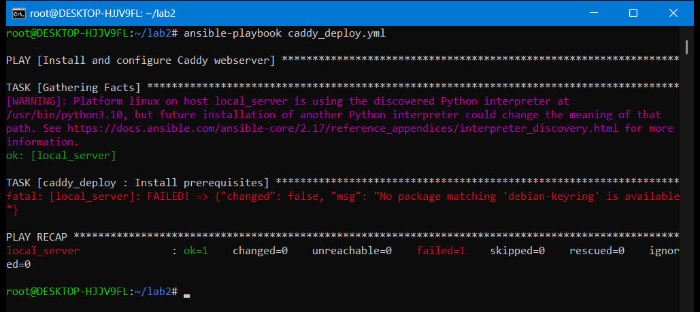

*Рисунок 7. Ошибка при первом запуске плейбука*

*Листинг 4. Файл roles/caddy_deploy/tasks/main.yml после части 2*

```yaml
---
# tasks file for caddy_deploy

- name: Install prerequisites
  apt:
    pkg:
      - debian-keyring
      - debian-archive-keyring
      - apt-transport-https
      - curl
    update_cache: yes

- name: Add key for Caddy repo
  apt_key:
    url: https://dl.cloudsmith.io/public/caddy/stable/gpg.key
    state: present
    keyring: /usr/share/keyrings/caddy-stable-archive-keyring.gpg

- name: add Caddy repo
  apt_repository:
    repo: "deb [signed-by=/usr/share/keyrings/caddy-stable-archive-keyring.gpg] https://dl.cloudsmith.io/public/caddy/stable/deb/debian any-version main"
    state: present
    filename: caddy-stable

- name: add Caddy src repo
  apt_repository:
    repo: "deb-src [signed-by=/usr/share/keyrings/caddy-stable-archive-keyring.gpg] https://dl.cloudsmith.io/public/caddy/stable/deb/debian any-version main"
    state: present
    filename: caddy-stable

- name: Install Caddy webserver
  apt:
    name: caddy
    update_cache: yes
    state: present
```

Повторный запуск прошёл без ошибок, все пять задач роли получили статус changed при failed=0 в итоговой строке PLAY RECAP (рисунок 8).

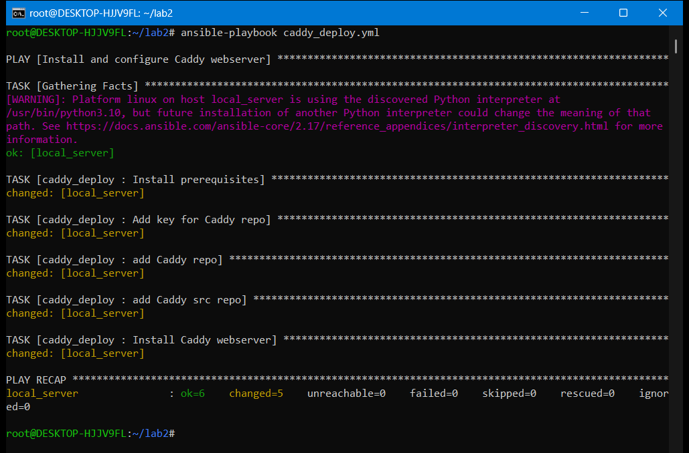

*Рисунок 8. Успешная установка Caddy плейбуком*

Установленный Caddy 2.11.9 работает как служба caddy, включённая в автозагрузку (рисунок 9). В поставляемом с пакетом файле `/etc/caddy/Caddyfile` сервер слушает порт 80 и отдаёт тестовую страницу из `/usr/share/caddy`, поэтому запрос к http://localhost вернул код 200 и заголовок Server: Caddy.

```bash
systemctl status caddy --no-pager -n 0
caddy version
curl -sI http://localhost
```

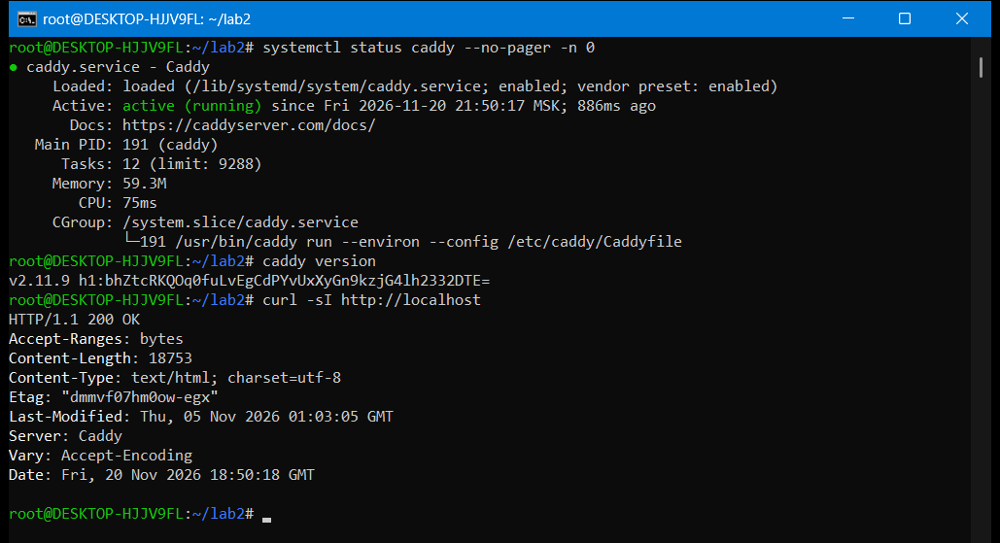

*Рисунок 9. Служба caddy и ответ сервера на порту 80*

### Часть 3. Домен и настройка Caddyfile

На сайте duckdns.org после входа через аккаунт GitHub был зарегистрирован домен khoskk-lab2.duckdns.org (рисунок 10, токен учётной записи на нём скрыт). Поскольку Caddy работает в WSL за NAT и из интернета недоступен, домену назначен адрес 127.0.0.1. По этому адресу браузер и curl на том же ноутбуке попадают на Caddy, так как WSL перенаправляет подключения к localhost из Windows в дистрибутив.

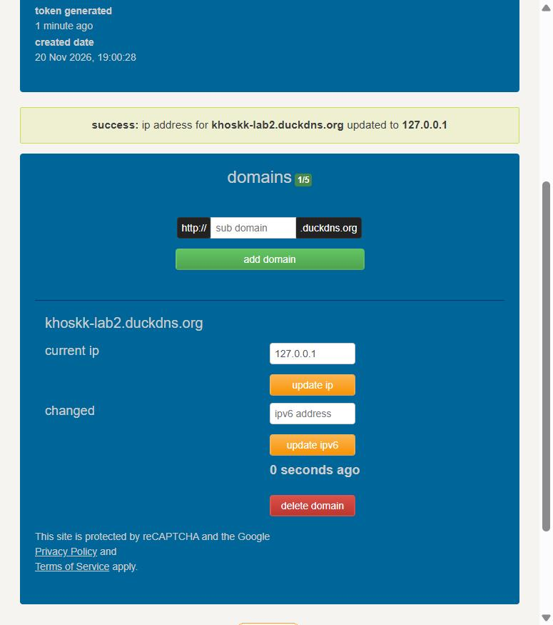

*Рисунок 10. Домен khoskk-lab2.duckdns.org на duckdns.org*

Шаблон `templates/Caddyfile.j2` и файл переменных `vars/main.yml` сначала были созданы точно по методическим указаниям. В tasks появились задача Create config file, которая модулем template формирует `/etc/caddy/Caddyfile` из шаблона с подстановкой имени домена и параметров журнала, и задача Reload with new config, перезагружающая конфигурацию службы. На второй из них запуск плейбука остановился (рисунок 11).

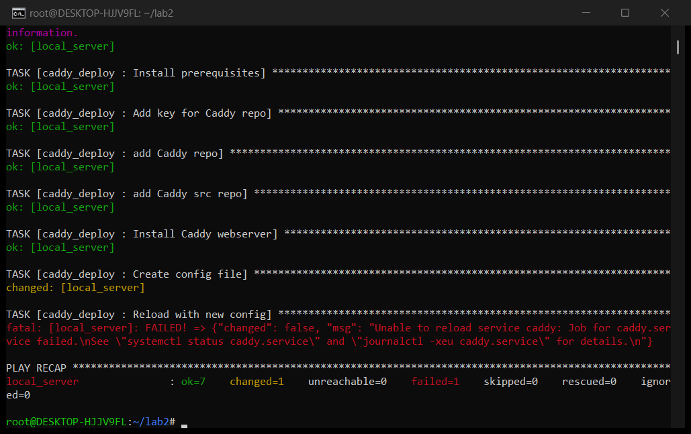

*Рисунок 11. Ошибка перезагрузки Caddy*

Судя по журналу службы, Caddy не смог открыть указанный в переменных файл `/var/log/caddy_access.log` (permission denied), поэтому новую конфигурацию не принял и продолжил работать с прежней (рисунок 12). Служба caddy работает от имени одноимённого пользователя, которому запись в каталог `/var/log`, принадлежащий root и группе syslog, недоступна. Для журналов пакет Caddy создаёт каталог `/var/log/caddy` с владельцем caddy, и после замены пути журнала в `vars/main.yml` на `/var/log/caddy/access.log` плейбук выполнился без ошибок.

```bash
journalctl -u caddy -n 2 --no-pager
journalctl -u caddy -n 4 -o cat | grep 'request error' | python3 -c 'import sys,json; print(json.load(sys.stdin)["error"])'
ls -ld /var/log /var/log/caddy
```

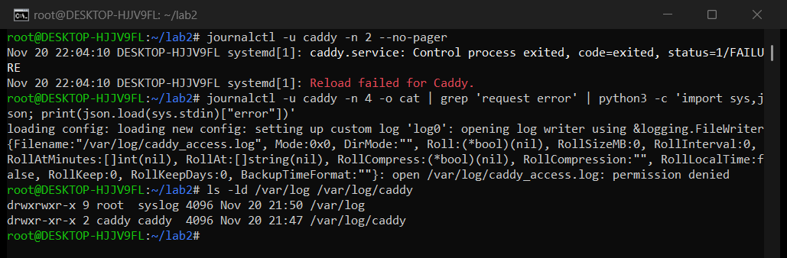

*Рисунок 12. Причина ошибки в журнале службы*

Открыть сайт по HTTPS после этого всё равно не удалось. Сертификата для домена у Caddy не было, поэтому на запрос curl сервер ответил TLS-оповещением internal error (рисунок 13). Проверки HTTP-01 и TLS-ALPN-01 Let's Encrypt отклонил с ошибкой «no valid A records found», что видно по журналу службы. При этих проверках серверы Let's Encrypt сами подключаются к адресу из A-записи домена, но 127.0.0.1 относится к зарезервированным адресам, для которых такие проверки не выполняются. Чтобы Caddy не повторял неудачные попытки, служба была остановлена командой `systemctl stop caddy`.

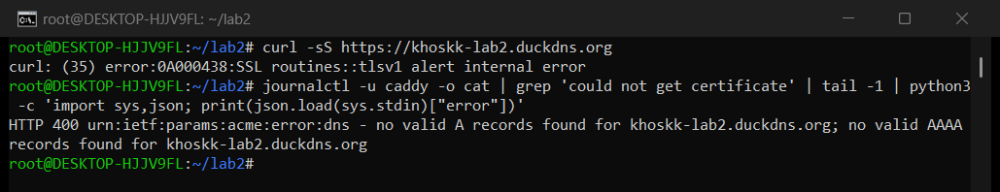

*Рисунок 13. Отказ Let's Encrypt в выдаче сертификата*

Для домена, адрес которого недоступен из интернета, сертификат можно получить проверкой DNS-01, при которой Caddy через API DuckDNS публикует TXT-запись `_acme-challenge.khoskk-lab2.duckdns.org` с проверочным значением; Let's Encrypt проверяет только эту запись и к самому серверу не подключается. Модуля для DuckDNS в стандартной сборке Caddy нет, поэтому в роль добавлены три задачи. Первая из них, Get list of Caddy modules, получает список модулей текущей сборки. Если модуля dns.providers.duckdns в нём нет, задача Add DuckDNS module to Caddy командой caddy add-package загружает с caddyserver.com сборку с модулем github.com/caddy-dns/duckdns и заменяет ею исполняемый файл, после чего задача Restart Caddy with new binary перезапускает службу, поскольку перезагрузка конфигурации нового исполняемого файла не подхватывает.

В шаблон добавлен блок tls с директивой dns duckdns, которой передаётся токен DuckDNS. Поскольку токен позволяет менять записи домена, он хранится отдельно от роли, в файле `secrets.yml` рядом с плейбуком, который подключает его через vars_files; в репозиторий попадает только образец `secrets.yml.example`. Так как токен оказывается и в `/etc/caddy/Caddyfile`, задаче Create config file заданы группа caddy и права 0640. С этими изменениями плейбук без ошибок установил модуль, перезапустил службу и применил конфигурацию (рисунок 14).

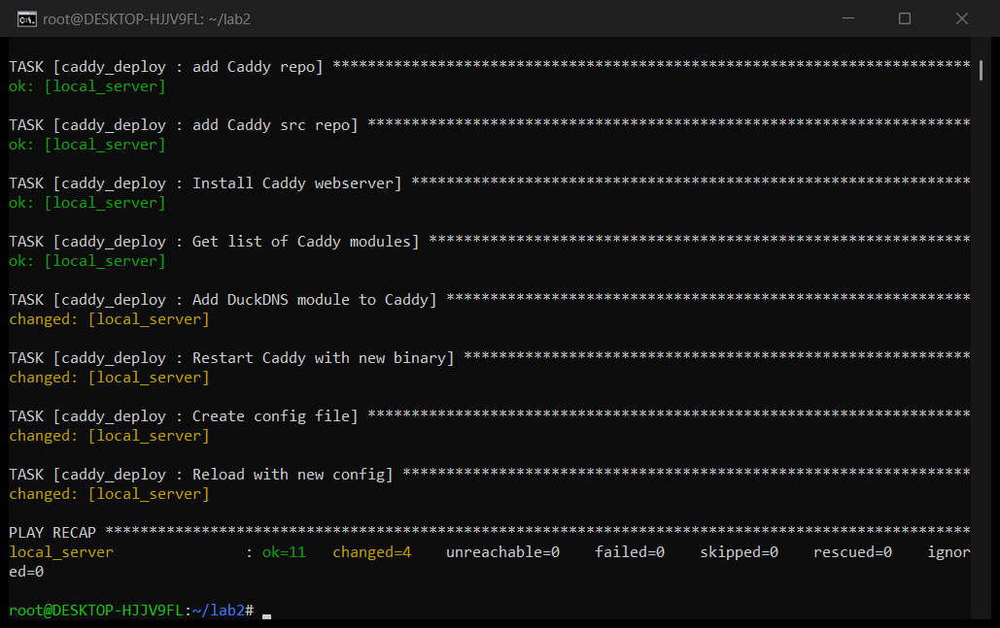

*Рисунок 14. Установка модуля DuckDNS и применение конфигурации*

Сертификат, однако, получен не был. Перед публикацией TXT-записи Caddy определяет зону домена по записи SOA, и такой запрос к DNS-серверу WSL 10.255.255.254 завершился по таймауту (рисунок 15). Команда dig подтвердила, что этот сервер на запросы SOA не отвечает, хотя обычные запросы A обрабатывает, тогда как публичный DNS-сервер 1.1.1.1 возвращает SOA зоны duckdns.org. Поэтому в блок tls добавлена директива resolvers 1.1.1.1, задающая DNS-сервер для проверки DNS-01.

```bash
grep nameserver /etc/resolv.conf
dig +short SOA duckdns.org
dig +short SOA duckdns.org @1.1.1.1
```

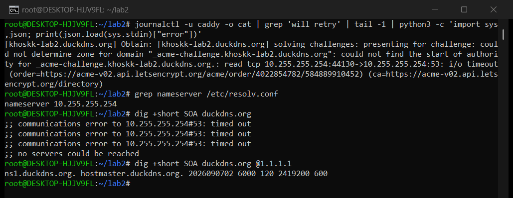

*Рисунок 15. Ошибка определения зоны и проверка DNS-серверов*

Шаблон, переменные, добавленные задачи и плейбук после всех изменений этой части приведены в листингах 5-8.

*Листинг 5. Файл roles/caddy_deploy/templates/Caddyfile.j2 после части 3*

```
{{ domain_name }} {
	root * /usr/share/caddy
	file_server

	tls {
		dns duckdns {{ duckdns_token }}
		resolvers 1.1.1.1
	}

	log {
		output file {{ log.file }}
		format json
		level {{ log.level }}
	}
}
```

*Листинг 6. Файл roles/caddy_deploy/vars/main.yml после части 3*

```yaml
---
# vars file for caddy_deploy

domain_name: khoskk-lab2.duckdns.org

log:
  file: /var/log/caddy/access.log
  level: "INFO"
```

*Листинг 7. Задачи, добавленные в roles/caddy_deploy/tasks/main.yml в части 3*

```yaml
- name: Get list of Caddy modules
  command: caddy list-modules
  register: caddy_modules
  changed_when: false

- name: Add DuckDNS module to Caddy
  command: caddy add-package github.com/caddy-dns/duckdns
  when: "'dns.providers.duckdns' not in caddy_modules.stdout"
  register: duckdns_module

- name: Restart Caddy with new binary
  service:
    name: caddy
    state: restarted
  when: duckdns_module is changed

- name: Create config file
  template:
    src: templates/Caddyfile.j2
    dest: /etc/caddy/Caddyfile
    group: caddy
    mode: "0640"

- name: Reload with new config
  service:
    name: caddy
    state: reloaded
```

*Листинг 8. Плейбук caddy_deploy.yml с подключением secrets.yml*

```yaml
---
- name: Install and configure Caddy webserver
  hosts: my_servers
  connection: local

  vars_files:
    - secrets.yml

  roles:
    - caddy_deploy
```

После следующего запуска плейбука в журнале службы появились запись о проверке dns-01 и сообщение certificate obtained successfully (рисунок 16). Судя по выводу curl -v, сертификат выдан на имя khoskk-lab2.duckdns.org центром Let's Encrypt (промежуточный сертификат YE2), действует с 20 ноября 2026 г. по 18 февраля 2027 г. и проходит проверку. В браузере Firefox по адресу https://khoskk-lab2.duckdns.org тестовая страница Caddy открылась без предупреждений о сертификате (рисунок 17).

```bash
journalctl -u caddy -o cat | grep -E 'dns-01|certificate obtained' | tail -2
curl -svI https://khoskk-lab2.duckdns.org 2>&1 | grep -E 'subject:|start date|expire date|issuer:|verify ok|< HTTP'
```

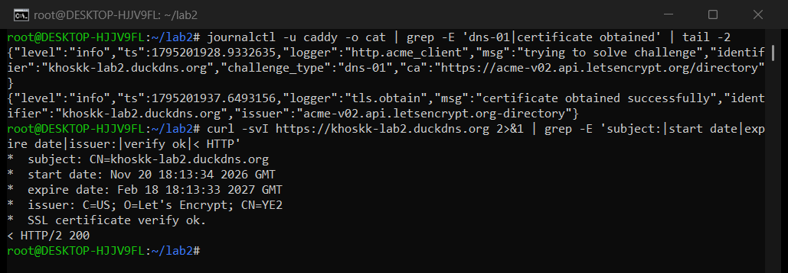

*Рисунок 16. Получение сертификата Let's Encrypt*

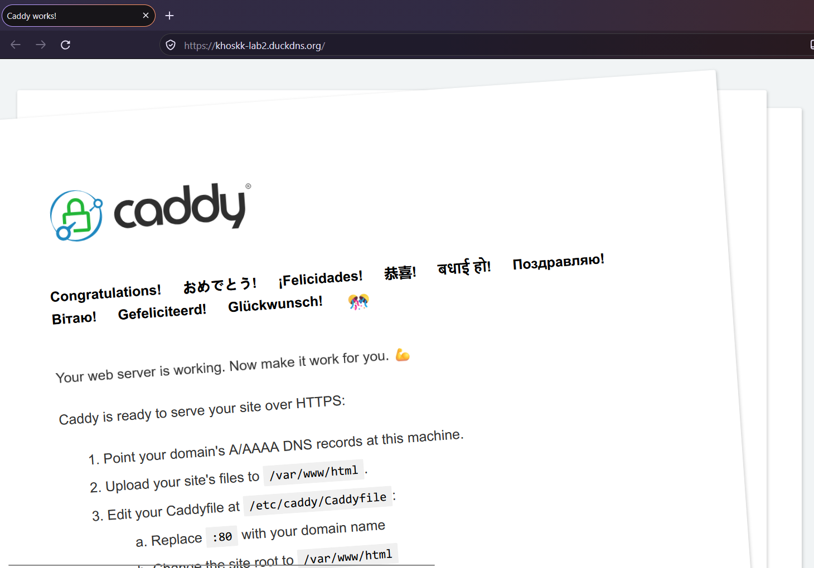

*Рисунок 17. Тестовая страница Caddy по HTTPS*

## Выполнение задания

### Задание 1

Ad-hoc команды из шага 5 части 1 перенесены в плейбук `file_playbook.yml` (листинг 9). Путь к файлу вынесен в переменную test_file и строится из факта ansible_env.HOME, то есть из домашнего каталога пользователя, от имени которого работает Ansible; сам файл создаётся модулем shell той же командой echo, что и в части 1. Проверку выполняют две задачи: модуль command читает файл командой cat и через register сохраняет вывод в переменную file_content, после чего модуль debug выводит прочитанное. Для чтения задано changed_when: false, так как оно не меняет состояние хоста. Добавленный по заданию шаг меняет содержимое файла модулем copy с параметром content, и только затем модуль file удаляет файл.

*Листинг 9. Плейбук file_playbook.yml*

```yaml
---
- name: Create, check, change and delete test file
  hosts: my_servers
  connection: local

  vars:
    test_file: "{{ ansible_env.HOME }}/test.txt"

  tasks:
    - name: Create test file
      shell: echo test_file_content > {{ test_file }}

    - name: Read test file
      command: cat {{ test_file }}
      register: file_content
      changed_when: false

    - name: Show test file content
      debug:
        msg: "{{ file_content.stdout }}"

    - name: Change test file content
      copy:
        content: "new_file_content\n"
        dest: "{{ test_file }}"

    - name: Delete test file
      file:
        path: "{{ test_file }}"
        state: absent
```

Плейбук запускался с ключом --diff, при котором Ansible показывает, что именно меняет каждая задача (рисунки 18 и 19). Задача Show test file content вывела строку test_file_content, значит файл создан с нужным содержимым. В выводе задачи Change test file content строка test_file_content заменена на new_file_content, для задачи Delete test file показана смена состояния файла с file на absent, и команда ls после плейбука подтвердила, что файла нет. Статус changed в PLAY RECAP имеют три задачи, которые создают, изменяют и удаляют файл.

```bash
ansible-playbook file_playbook.yml --diff
ls -l ~/test.txt
```

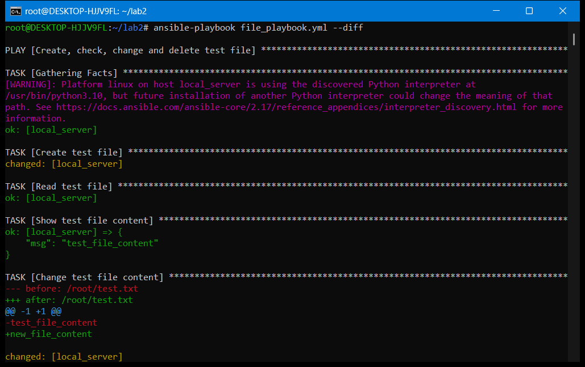

*Рисунок 18. Выполнение плейбука file_playbook.yml, начало*

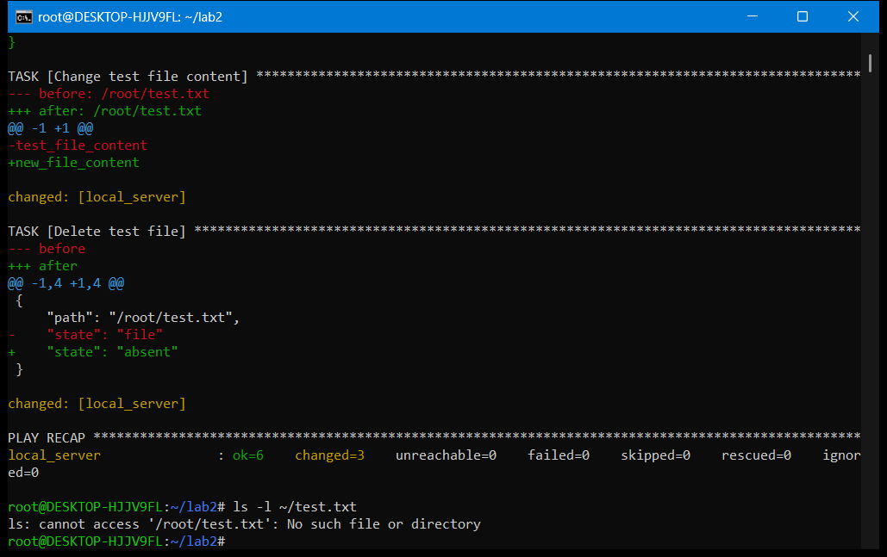

*Рисунок 19. Выполнение плейбука file_playbook.yml, окончание*

### Задание 2a

В расширенной конфигурации Caddy (листинг 10) сервер вместо тестовой страницы отдаёт собственную страницу `index.html` с текстом Hello world (листинг 11) из каталога `/var/www/html`, который задан переменной site_root в `vars/main.yml` и подставляется в директиву root шаблона. Блок header добавляет к ответам заголовок X-Lab со значением «Ansible + Caddy» и заголовок X-Content-Type-Options: nosniff, запрещающий браузеру угадывать тип содержимого. Строка -Server удаляет заголовок Server, по которому видно, какой веб-сервер отвечает.

*Листинг 10. Итоговый файл roles/caddy_deploy/templates/Caddyfile.j2*

```
{{ domain_name }} {
	root * {{ site_root }}
	file_server

	header {
		X-Lab "Ansible + Caddy"
		X-Content-Type-Options nosniff
		-Server
	}

	tls {
		dns duckdns {{ duckdns_token }}
		resolvers 1.1.1.1
	}

	log {
		output file {{ log.file }}
		format json
		level {{ log.level }}
	}
}
```

*Листинг 11. Файл roles/caddy_deploy/files/index.html*

```html
<!DOCTYPE html>
<html lang="ru">
<head>
  <meta charset="utf-8">
  <title>Hello world</title>
</head>
<body>
  <h1>Hello world!</h1>
  <p>Страница развёрнута на веб-сервере Caddy с помощью Ansible.</p>
</body>
</html>
```

Страница хранится в каталоге files роли, а перед формированием Caddyfile в tasks добавлены два шага (листинг 12). Задача Create site directory создаёт каталог сайта модулем file, поскольку модуль copy отсутствующий каталог назначения не создаёт; задача Copy index page копирует в него страницу.

*Листинг 12. Задачи, добавленные в roles/caddy_deploy/tasks/main.yml в задании 2a*

```yaml
- name: Create site directory
  file:
    path: "{{ site_root }}"
    state: directory

- name: Copy index page
  copy:
    src: index.html
    dest: "{{ site_root }}/index.html"
```

Плейбук выполнился без ошибок (рисунок 20). Задачи установки модуля DuckDNS были пропущены (skipping), так как модуль уже есть в сборке, и статус changed получили четыре задачи: создание каталога, копирование страницы, обновление Caddyfile и перезагрузка службы.

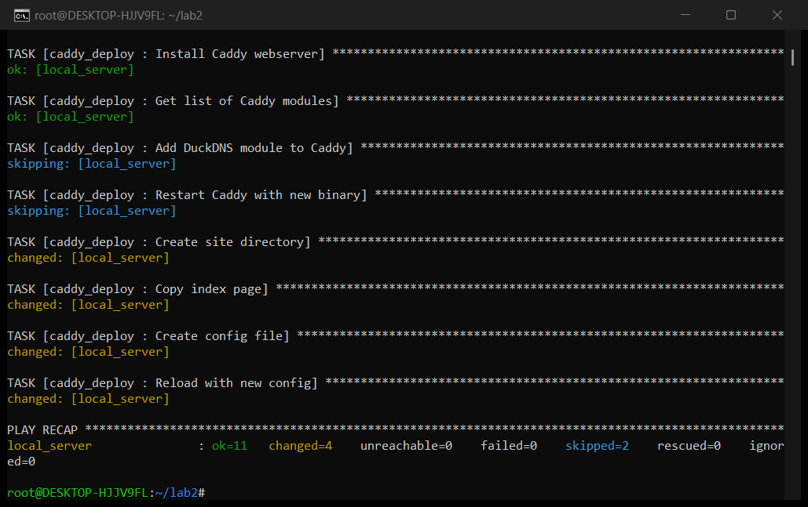

*Рисунок 20. Применение расширенной конфигурации Caddy*

В ответе сервера, полученном командой curl (рисунок 21), есть заголовки x-lab: Ansible + Caddy и x-content-type-options: nosniff и нет заголовка server. Тело ответа совпадает с файлом `index.html`, а сам запрос записан в журнал `/var/log/caddy/access.log` в формате JSON. В браузере по адресу https://khoskk-lab2.duckdns.org открылась новая страница (рисунок 22).

```bash
curl -sI https://khoskk-lab2.duckdns.org
curl -s https://khoskk-lab2.duckdns.org
tail -n 1 /var/log/caddy/access.log | cut -c1-200
```

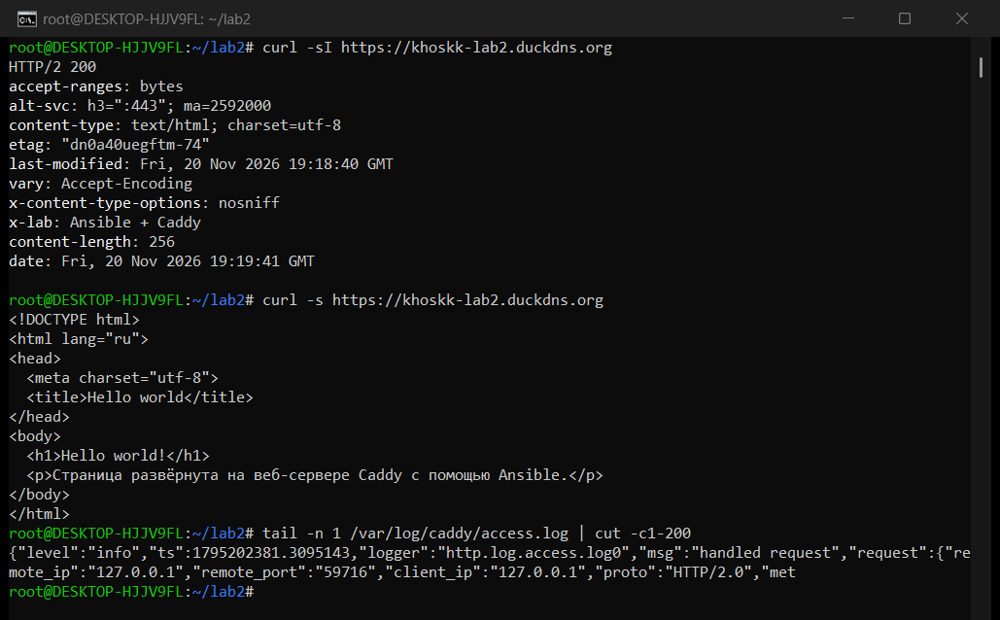

*Рисунок 21. Заголовки и тело ответа сервера*

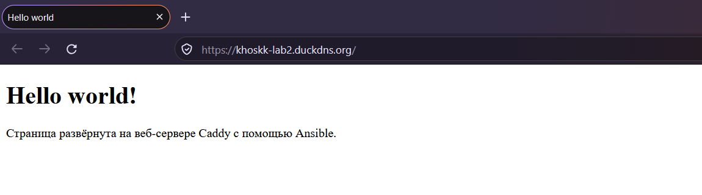

*Рисунок 22. Собственная страница в браузере*

## Вывод

Ansible 10.7.0, установленный через pip на Ubuntu 22.04 в WSL, управлял этой же машиной через локальное подключение. Роль caddy_deploy из 12 задач устанавливает Caddy 2.11.9 из официального репозитория, формирует Caddyfile из шаблона Jinja2 и публикует на домене khoskk-lab2.duckdns.org собственную страницу с дополнительными заголовками по HTTPS с сертификатом Let's Encrypt, действующим до 18 февраля 2027 г.; при повторных запусках задачи установки получали статус ok, а замена сборки Caddy пропускалась. Пример из методических указаний на этом стенде пришлось дополнить. Так, в образе WSL для установки debian-keyring потребовалось обновить списки пакетов apt, журнал Caddy перенесён в каталог `/var/log/caddy`, куда может писать пользователь caddy, а сертификат для домена с адресом 127.0.0.1 получен проверкой DNS-01 через API DuckDNS, для чего в Caddy добавлен модуль caddy-dns/duckdns и задан DNS-сервер 1.1.1.1. Плейбук из задания 1 выполнил создание, проверку, изменение и удаление файла, причём статус changed получили только три задачи, которые меняли файл.
